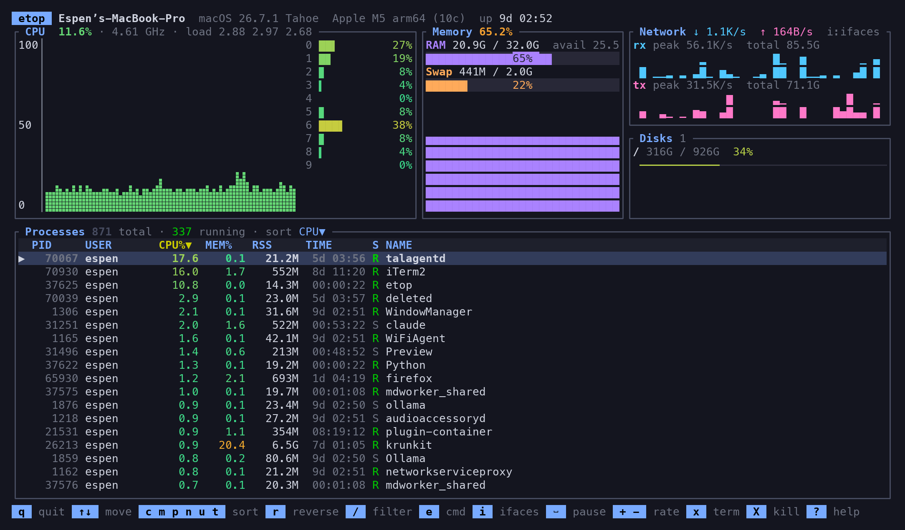

# etop

A visual, cross-platform system monitor for the terminal. Think `top`, with the
graphs and colour of `btop`, in a single small binary.

Built with [ratatui](https://ratatui.rs) and [sysinfo](https://crates.io/crates/sysinfo).
Supports Linux and macOS on x86_64 and arm64.



## Features

- CPU history graph (braille, area-filled) plus a per-core bar for every core,
  coloured on a green → yellow → red heat scale
- Memory and swap gauges with a used-memory history sparkline
- Network receive / transmit sparklines with peak and total counters, or a
  per-interface table of current rates and totals (toggle with `i`)
- Disk usage gauges per mounted filesystem
- Process table with CPU, memory, RSS, thread count (Linux), run time and state
- Sort by CPU, memory, PID, name, user or run time; reverse any sort
- Incremental filter over name, command line, user or PID
- Send SIGTERM or SIGKILL to the selected process, with confirmation
- Pause sampling, adjust refresh rate at runtime
- Sampling runs on a background thread so the UI never stalls

## Install

```sh
cargo install --path .
```

Or build a release binary:

```sh
cargo build --release
./target/release/etop
```

## Usage

```
etop [-r <ms>]

  -r, --rate <MS>   Refresh interval in milliseconds (default 1000, min 250)
  -h, --help        Print help
  -V, --version     Print version
```

### Keys

| Key              | Action                                        |
| ---------------- | --------------------------------------------- |
| `q` / `Esc`      | quit                                          |
| `↑` `↓` / `j` `k`| move selection                                |
| `PgUp` `PgDn`    | move 20 rows (also `Ctrl-u` / `Ctrl-d`)       |
| `g` / `G`        | first / last row                              |
| `c` `m` `p` `n` `u` `t` | sort by CPU, memory, PID, name, user, time |
| `r`              | reverse sort order                            |
| `/`              | filter (Enter to apply, Esc to clear)         |
| `e`              | toggle process name / full command line       |
| `i`              | toggle network graphs / per-interface table   |
| `space`          | pause / resume sampling                       |
| `+` / `-`        | faster / slower refresh                       |
| `x` / `Del`      | send SIGTERM to selected process              |
| `X` / `F9`       | send SIGKILL to selected process              |
| `?` / `F1`       | help                                          |

Process CPU% is relative to one core, as in `top` and `htop`, so a process can
exceed 100% on a multi-core machine.

## Cross-compiling

Targets are added with `rustup target add <triple>`.

| Target                      | From macOS                                         |
| --------------------------- | -------------------------------------------------- |
| `x86_64-apple-darwin`       | `cargo build --release --target x86_64-apple-darwin` (works out of the box on Apple Silicon) |
| `aarch64-apple-darwin`      | `cargo build --release --target aarch64-apple-darwin` |
| `x86_64-unknown-linux-musl` | `cargo install cargo-zigbuild` (needs `zig`), then `cargo zigbuild --release --target x86_64-unknown-linux-musl` |

The musl target gives a fully static Linux binary that runs on any amd64 distro.

## Packages and releases

`.github/workflows/build.yml` runs on every push and pull request. It lints,
builds static Linux binaries (amd64, arm64) and macOS binaries (x86_64, arm64),
and produces `.deb` and `.rpm` packages for both Linux architectures. Pushing a
`v*` tag attaches all of them, plus a `SHA256SUMS` file, to a GitHub release.

To build the packages locally on Linux:

```sh
cargo install cargo-deb cargo-generate-rpm
cargo build --release
cargo deb --no-build
cargo generate-rpm
```

## Screenshot

`docs/screenshot.py` regenerates `docs/screenshot.png` by running the release
binary in a pseudo-terminal and rasterising the captured screen. It needs
Python with `pyte` and `pillow`, and the Menlo font, so it is macOS only.

## License

MIT
